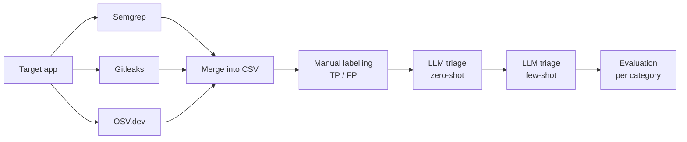

# LLM-Based Triage of DevSecOps Scanner Findings

Does a large language model triage security findings equally well across different kinds of scanner? This project tests that question on three categories of finding produced in a DevSecOps pipeline:

- **SAST** (static code analysis) from Semgrep
- **Secrets** (hard-coded credentials) from Gitleaks
- **Dependencies** (known vulnerable packages) from the OSV.dev database

Each finding is sent to an LLM, which labels it a **true positive** (a genuine, exploitable issue) or a **false positive** (noise). The labels are then scored against a hand-labelled ground truth, separately for each category, under two prompting strategies: **zero-shot** and **few-shot**.

This repository contains the code from my MSc Cyber Security dissertation at De Montfort University (2026):

> *Cross-Category Comparison of LLM-Based Triage for SAST, Secrets, and Dependency Findings in a DevSecOps CI/CD Pipeline*

## Key finding

The effect of prompting strategy depends on the category. Few-shot prompting improved triage of dependency and secrets findings but reduced recall on SAST findings. A single overall score hides this, because the large dependency category outweighs the SAST decline.

| Category | Findings | F1 zero-shot | F1 few-shot |
|---|---:|---:|---:|
| SAST | 27 | 0.9615 | 0.8750 |
| Secrets | 2 | 0.6667 | 1.0000 |
| Dependency | 74 | 0.8837 | 0.9630 |
| **Overall** | **103** | **0.9022** | **0.9412** |

The Secrets category has only two findings, so treat its scores as indicative only.

## How it works



1. **Scan.** An Azure DevOps pipeline clones the target app and runs the three scanners.
2. **Build the dataset.** The findings are merged into one CSV with blank `GroundTruth` and `Reason` columns.
3. **Label.** Each finding is reviewed by hand and marked TP or FP with a short reason.
4. **Triage.** The triage runner sends every finding to the LLM, first zero-shot, then few-shot.
5. **Evaluate.** Precision, recall, F1 and accuracy are calculated per category and overall.

## Repository layout

```
pipeline/
  azure-pipelines.yml      Scanning pipeline (Azure DevOps)
scripts/
  osv_scan.py              Dependency scan against the OSV.dev API
  build_dataset.py         Merges scanner output into the labelling CSV
src/TriageRunner/          .NET 8 console app
  Prompts/                 Zero-shot and few-shot prompt strategies
  Llm/                     Groq API client and verdict parsing
  Evaluation/              Confusion matrix and metrics
  Csv/                     CSV reading and writing
data/                      Labelled dataset, results and metrics
```

## Target application

The scanned application is the [OWASP Vulnerable Flask App](https://github.com/anil-yelken/Vulnerable-Flask-App) by Anil Yelken, a deliberately insecure Python app. It is not included in this repository. The pipeline clones it at run time.

## Requirements

- .NET 8 SDK
- Python 3.11 (for the scanning scripts)
- A [Groq](https://console.groq.com) API key

## Running it

### 1. Scan (optional)

Import `pipeline/azure-pipelines.yml` into an Azure DevOps project that contains this repository and run it. The `scan-results` artifact contains the raw scanner reports and `labeled_with_groundtruth.csv`.

The labelled dataset used in the study is already in `data/`, so you can skip this step and go straight to triage.

### 2. Set your API key

Windows:
```
set GROQ_API_KEY=your-key-here
```

Linux or macOS:
```
export GROQ_API_KEY=your-key-here
```

### 3. Run triage and evaluation

From the repository root:

```
dotnet run --project src/TriageRunner -- --mode zero-shot --input data/labeled_with_groundtruth.csv --output data/zero_shot_results.csv

dotnet run --project src/TriageRunner -- --mode few-shot --input data/zero_shot_results.csv --output data/few_shot_results.csv

dotnet run --project src/TriageRunner -- --mode evaluate --input data/few_shot_results.csv --output data/metrics.csv
```

The few-shot run adds an `LlmVerdict_FewShot` column next to the zero-shot `LlmVerdict` column. The evaluate step needs no API key.

Run `dotnet run --project src/TriageRunner -- --help` for all options.

## Experimental setup

| Setting | Value |
|---|---|
| Model | `openai/gpt-oss-120b` via the Groq API |
| Temperature | 0 |
| Reasoning effort | low |
| Max tokens | 500 |
| Output | One word, TP or FP |
| Few-shot examples | 5, hand-written, not taken from the evaluation set |

The prompts are fixed in `src/TriageRunner/Prompts/`. Changing their wording will change the results.

## Notes

- **Dependency tool name.** The pipeline queries the OSV.dev database directly. The dataset labels these rows `pip-audit` to match the original study data.
- **Few-shot examples.** Two of the five examples name `safety` as the tool. They are kept exactly as used in the study so the results can be reproduced.
- **Evaluation method.** The positive class is TP. The overall row pools all findings before computing metrics (micro-averaging). ERROR or UNCLEAR replies count as a negative prediction.
- **Reproducibility.** LLM output can vary slightly between runs even at temperature 0, and hosted models change over time. Expect results close to, but not always identical to, those reported.

## Licence

MIT. See [LICENSE](LICENSE).

## Author

**Musawar Mustafa**
MSc Cyber Security, De Montfort University
